# Berber Randevu Uygulaması

Berber ve kuaför dükkânları için **Flutter + Firebase** ile geliştirdiğim mobil randevu sistemi. Müşteri, berber (dükkân sahibi) ve usta (personel) olmak üzere üç rolü var.

> Bu repo bir vitrin reposudur: ekran görüntüleri ve özellikleri içerir. Kaynak kod özeldir.
> Ekranlardaki veriler demo verisidir.

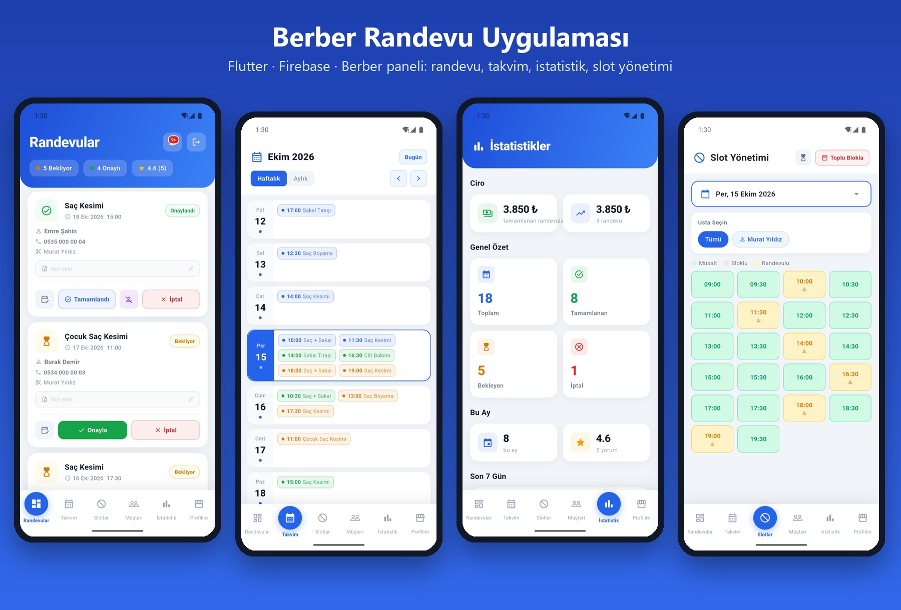
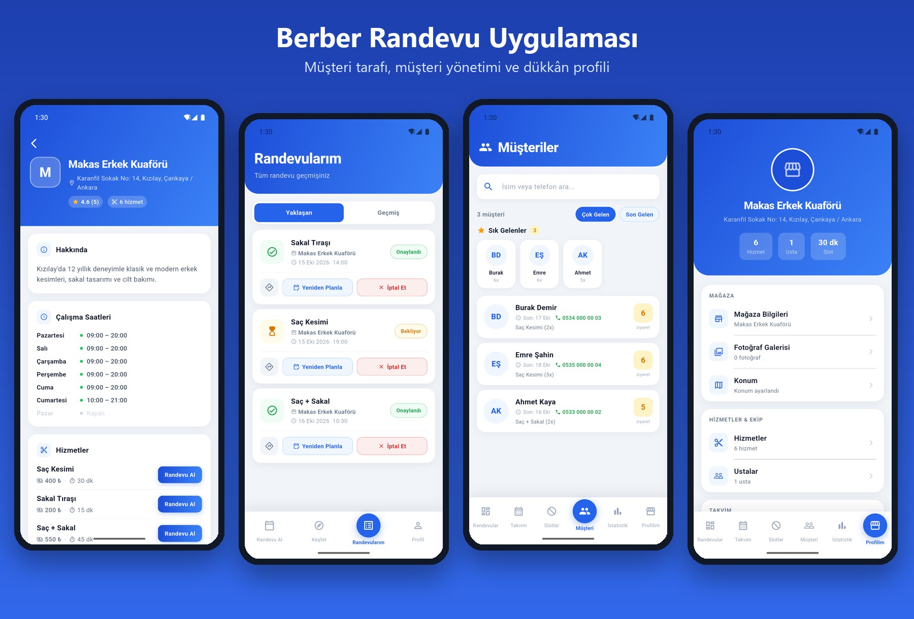

## Özellikler

**Müşteri**
- Berber arama, liste ve harita görünümü (konuma göre yakındaki dükkânlar)
- Usta ve hizmet seçip uygun saatten randevu alma (dolu saatler gösterilir)
- Randevularım: yaklaşan / geçmiş, iptal ve yeniden planlama
- Favori berberler, yorum ve puan verme
- Bekleme listesi: dolu saat boşalınca haber alma

**Berber (dükkân sahibi)**
- Gelen randevuları onaylama, tamamlama, iptal, "gelmedi" olarak işaretleme
- Haftalık / aylık takvim görünümü
- Slot yönetimi: saat bloklama, toplu bloklama
- Müşteri listesi: sık gelenler, ziyaret sayısı, müşteriye özel notlar
- İstatistikler: ciro, tamamlanan / bekleyen / iptal randevular, ortalama puan
- Dükkân profili: hizmetler ve fiyatlar, çalışma saatleri, galeri, konum
- Usta ekleme ve ustaya özel çalışma saatleri

**Altyapı**
- Push bildirimleri (Firebase Cloud Messaging + Cloud Functions)
- Firestore güvenlik kuralları ile rol bazlı yetki (müşteri yalnızca kendi randevusunu yönetir)
- Çakışmayı önleyen transaction tabanlı randevu kaydı

## Teknolojiler
`Flutter` `Dart` `Firebase Auth` `Cloud Firestore` `Cloud Functions` `FCM` `flutter_map` `geolocator`

## Ekranlar
| | | | |
|---|---|---|---|
| 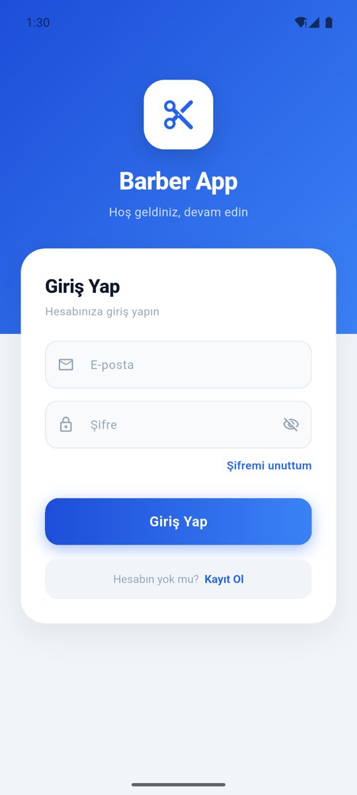 | 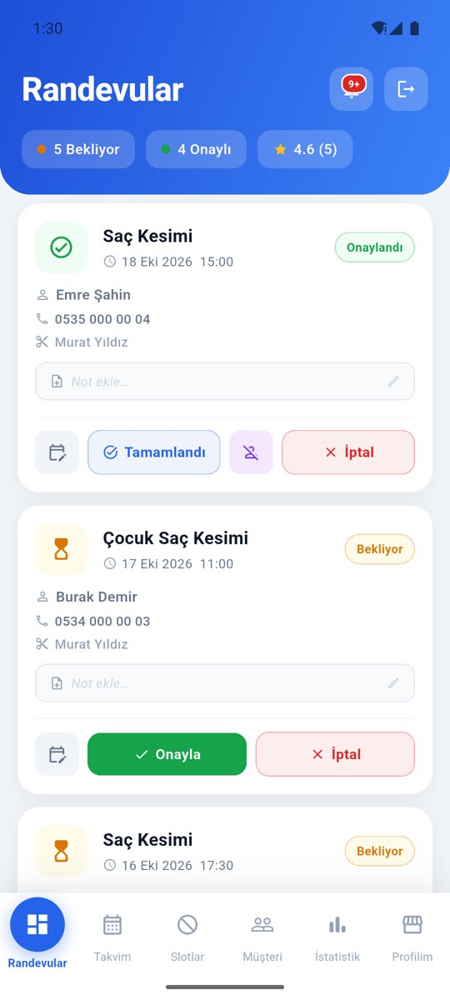 | 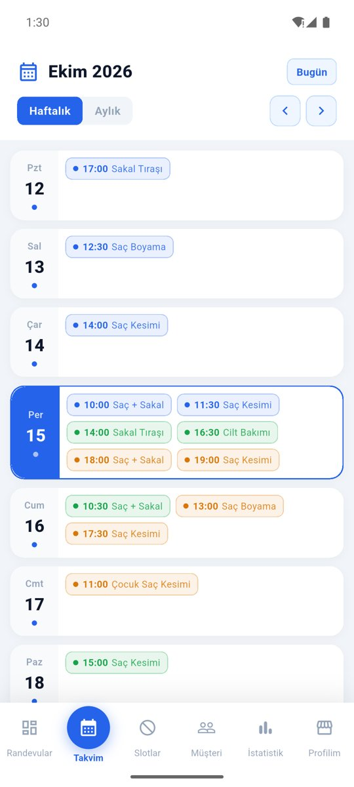 | 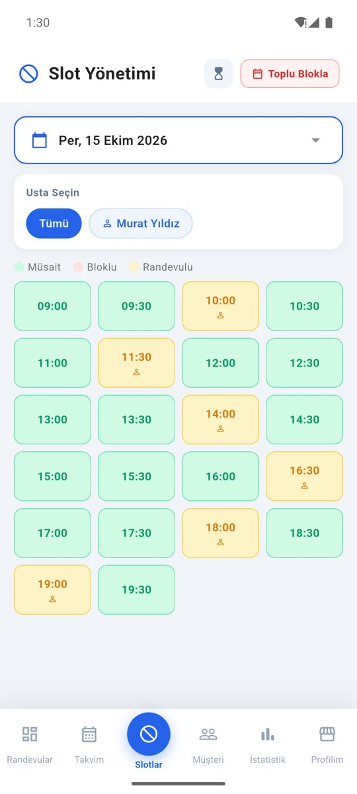 |
| Giriş | Randevular | Takvim | Slot yönetimi |
| 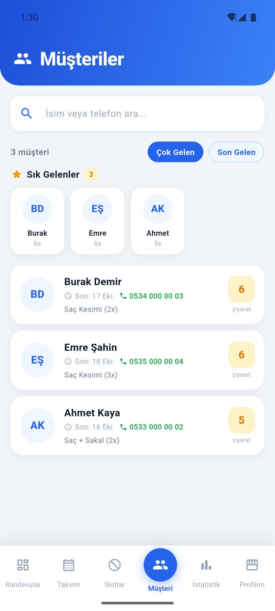 | 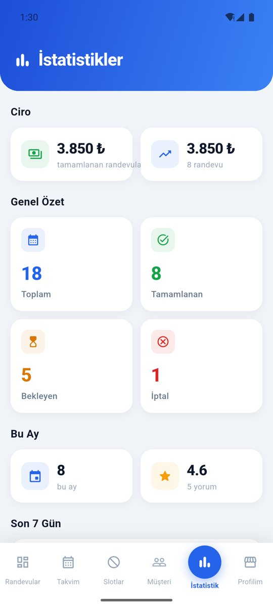 | 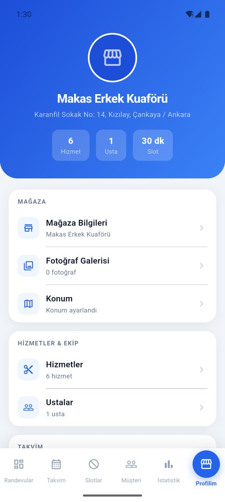 | 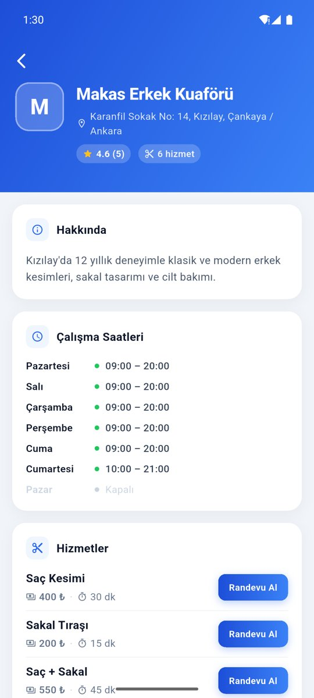 |
| Müşteriler | İstatistikler | Dükkân profili | Berber detayı (müşteri) |
| 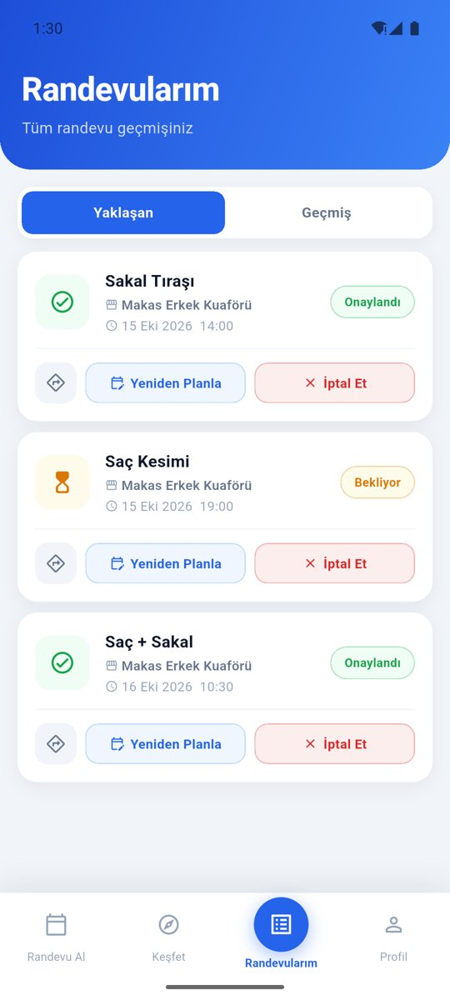 | 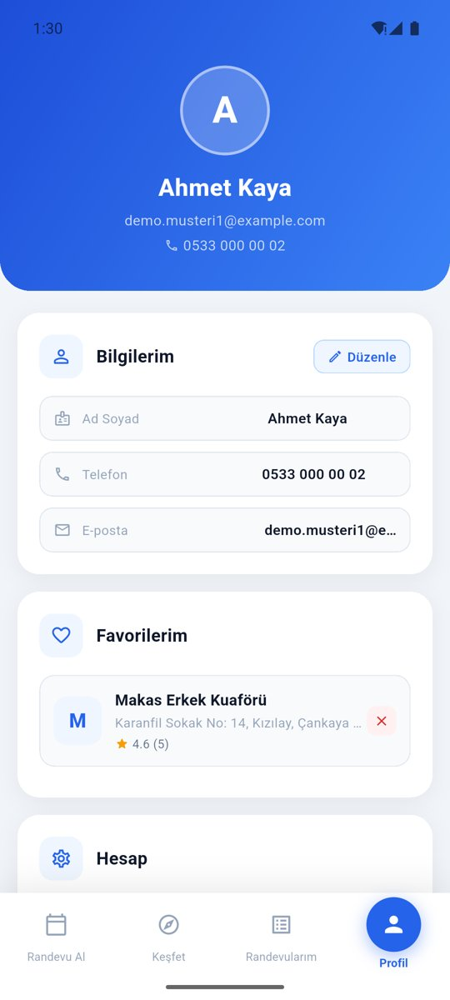 | | |
| Randevularım (müşteri) | Profil (müşteri) | | |
